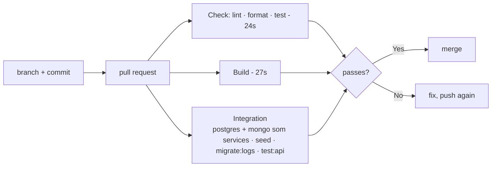

# Pipeline

## Vad som körs, och varför

| Jobb               | Vad                                                      | Fångar                                                                                                                                       | Tar                              |
| ------------------ | -------------------------------------------------------- | -------------------------------------------------------------------------------------------------------------------------------------------- | -------------------------------- |
| `checks`           | typecheck, lint, format:check, klientens tester          | typfel, stil, vyer som visar fel                                                                                                             | ~24 s                            |
| `build`            | `npm run build`                                          | klienten som inte går att bygga                                                                                                              | ~27 s                            |
| `integration` (M5) | `npm run test:api` mot Postgres och Mongo som _services_ | resolvers som inte stämmer med databasen, N+1 som kommit tillbaka, mutationer utan inloggningskrav – det klientens mockade tester aldrig ser | ~40 s inkl. start av databaserna |
| `image`            | bygger api- och client-imagen, publicerar i GHCR på main | Dockerfiler som inte går att bygga                                                                                                           | –                                |

## Branch protection

- Kräver status checks **checks**, **build** och **integration** gröna innan merge

## Vanliga fel

- **integration rött men testerna gröna lokalt:** databasen i jobbet är tom tills `npm run seed` körts, och `Tour.logs` läser Mongo – `npm run migrate:logs` måste också ha körts. Portarna är `5432`/`27017` på `localhost` i jobbet, inte `5433` som i compose. Variabeln heter `POSTGRES_URL` (som i `api/src/config.js`), inte `DATABASE_URL`.
